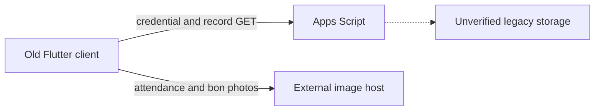
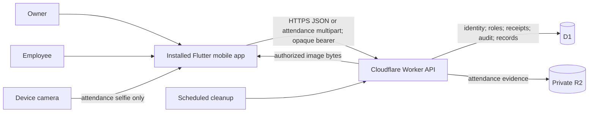
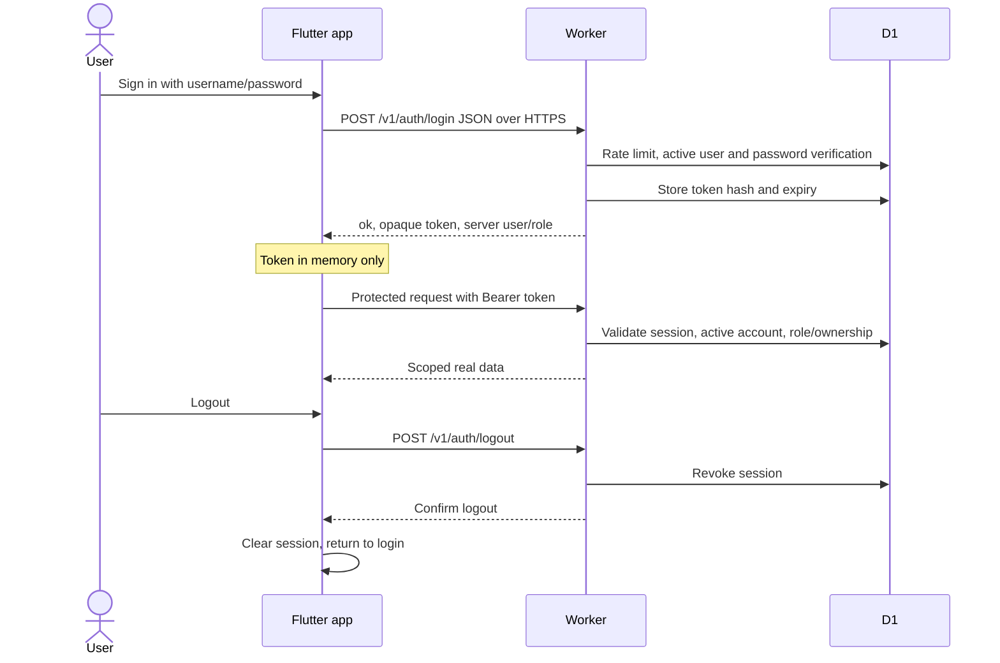
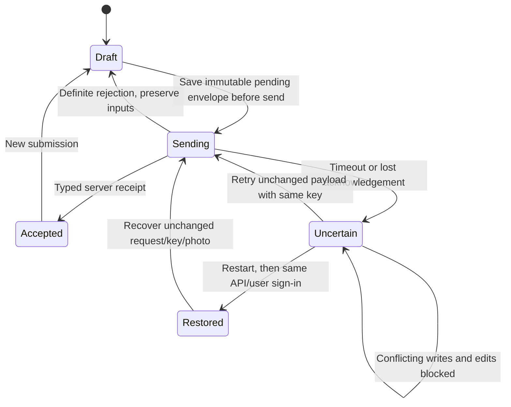
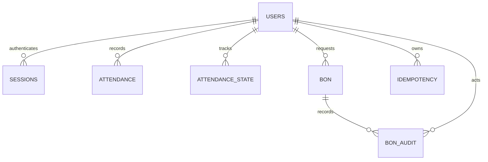
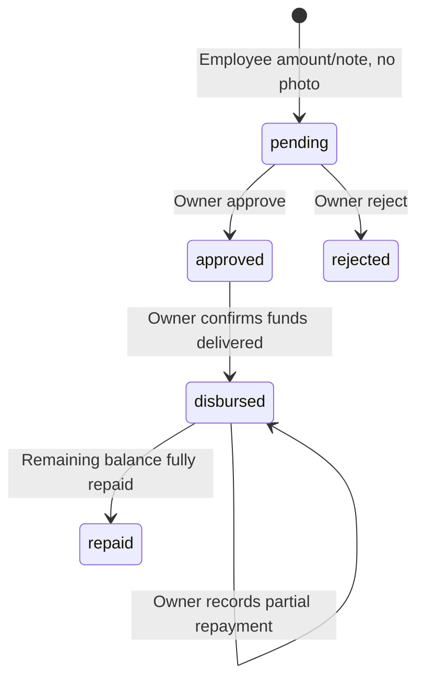

# Software Design Document (SDD)

> Proposed evolution: [customer-owned deployment (BYOC)](BYOC.md). Each business would own its environment; automatic provisioning, workspace pairing and customer updates are not implemented.

**Product:** Absensi & Bon Karyawan\
**Version:** 1.1 · 17 November 2026 (Asia/Jakarta)\
**Status:** Implementation architecture and target invariants; operational qualification pending.

Related: [PRD](PRD.md), [TSD](TSD.md), [migration plan](MIGRATION.md), [documentation guide](README.md). Exact backend setup/configuration is maintained in the [backend guide](../cloudflare/README.md).

## 1. Architecture and evolution

The current implementation replaces the old Apps Script/Imgur client with an installed Flutter Android/iOS app backed by Workers, D1, and private R2. The diagrams separate that prior baseline from the implementation/target system. They do not assert live deployment. One business per deployment is the MVP assumption; no multi-tenant isolation is designed.

**Prior baseline — replaced, not a fallback:**



**Current implementation / v1.1 target — deployment pending:**



The mobile client never receives an R2 credential or public object URL. The Worker is the access boundary for records and photos. D1 owns authoritative identity, timestamps, financial state, audit and idempotency receipts; R2 owns attendance image bytes. There is no bon image path.

## 2. Components and navigation

| Component | Design responsibility |
| --- | --- |
| [App entry](../lib/main.dart) | Create/close the shared API client, apply shared theme, open login with normal TLS. |
| [API client](../lib/api_client.dart) | Validate HTTPS base URL, store bearer in memory, encode requests, enforce deadlines, decode receipts/errors, fetch protected photos. |
| [Models](../lib/models.dart) | Server identity, attendance/bon records and dashboard summary; never use display name as authority. |
| [Login](../lib/login_page.dart) | Local validation, real authentication, role/user handoff. No demo session. |
| [Home](../lib/home_page.dart) | Role-specific tabs, server dashboard, logout, preserve in-memory tab state. |
| [Employees](../lib/employees_page.dart) | Owner create/read/edit, active toggle, password reset; username fixed after create. |
| [Attendance](../lib/absensi_page.dart) | Employee camera draft/send; owner/self history and private image review. |
| [Bon](../lib/bon_page.dart) | Employee amount/note request without camera; history/status and owner financial actions. |
| [UI helpers](../lib/ui.dart) | Consistent status, error, loading and empty states for Indonesian mobile workflows. |
| [Worker](../cloudflare/src/index.js) / [schema](../cloudflare/migrations/0001_initial.sql) | Enforce authorization, ordered attendance, financial constraints and durable mutation receipts. |

Owner navigation: Ringkasan → Karyawan / Absensi / Bon. Employee navigation: Beranda → Absensi / Bon / Akun. Both have logout. Role checks in UI improve clarity; every privileged action still requires server enforcement. The client shows real empty/error states when data is absent/unreachable. No fabricated attendance, balances, employee names, or successful offline writes are allowed.

## 3. Session and interaction design



Process restart loses the token. Server expiry, password reset or activation changes revoke access even if the old screen remains in memory. Failed logout must remain distinguishable from confirmed revocation; do not promise remote logout when the server cannot be reached. After sign-in, restore any durable pending operation for the same API/user and show the Home recovery banner. Persistent sign-in and a general offline queue remain outside the MVP.

```mermaid
sequenceDiagram
    actor Employee
    participant Form as Attendance form
    participant API as Worker
    participant Store as Private R2
    participant DB as D1
    Employee->>Form: Select check_in/out, capture/preview selfie
    Form->>API: Multipart kind/photo, bearer, Idempotency-Key
    API->>API: Validate role, photo, fingerprint
    API->>DB: Look up receipt for actor/key
    alt Existing same request
        DB-->>API: Accepted receipt
    else New request
        API->>DB: Store durable pending photo intent and lease
        API->>Store: Put private attendance object
        API->>DB: Atomic alternating state, attendance and receipt
        DB-->>API: Accepted server record
    end
    API-->>Form: ok:true, record with server ID/time
    Form->>Form: Show receipt, clear sent photo only
    Note over Form,DB: Lost response: same key + same payload retry; do not assume rollback
```

D1/R2 operations are not a distributed transaction. A durable upload intent precedes PUT; accepted attendance commits that intent atomically. Cleanup claims expired unreferenced intents, blocks late inserts through a trigger, and repeats deletion using retained tombstones to catch delayed PUTs. Accepted image references are excluded. An ambiguous outcome may already have committed: preserve/reconcile ownership before cleanup. Referenced-photo retention is a distinct scheduled policy, disabled by default until explicitly configured; see the [backend guide](../cloudflare/README.md) for exact cleanup behavior.

## 4. State and data ownership



Durable recovery is implemented in the [pending store](../lib/pending_store.dart). Before sending attendance/bon or owner actions, store an immutable envelope and attendance photo bytes in app-private storage scoped to API + user; never store tokens/passwords. Login restores the scope and Home offers recovery. One pending operation blocks conflicting writes; form fields and owner action values remain locked until resolved. Malformed typed HTTP 200 receipts stay uncertain. The final 33-test Flutter suite passed, including recovery banner replay and dashboard refresh coverage. Camera cancellation preserves the prior valid image; permission/capture failure leaves a recovery message. Controllers and post-await UI updates must respect widget disposal.



Logical relationships above are backed by the [migration](../cloudflare/migrations/0001_initial.sql); read it for exact SQL details. Employee deactivation retains relationships. Attendance state enforces alternating check-in/out across midnight, independent of daily quotas. Owner account provisioning is an operational bootstrap, never a public registration route.

## 5. Bon lifecycle and accounting



All actions use a stable key, server time, role check, expected-state guard, and audit entry in the database transaction. Concurrent updates cannot repay more than the remaining balance. Rejection is terminal in this MVP; reversal/reopening/deleting financial history is not defined. The app records confirmation of money movement outside the system.

Outstanding debt is the sum of `amount - repaidAmount` for disbursed records only. Pending/approved requests are not loans already paid. Dashboard aggregates cover the authorized server scope; any subtotal derived from a loaded history window must say that it covers loaded records. Historical entries cannot be assigned a lifecycle state merely from an old row amount or photo.

## 6. Design tradeoffs and remaining work

Use ordinary Flutter local widget state and a shared API client rather than adding a new global framework. This keeps the app small while separating transport/model logic from screens. Mobile filesystem/camera use is intentional; web scaffolds do not define product support.

Opaque memory sessions avoid shipping/persisting a durable credential but require login after restart. Private Worker-proxied photos simplify access checks but consume Worker requests and R2 read allowances. Single-business deployment avoids an incomplete tenant model; supporting multiple businesses later requires schema and authorization changes. Password KDF security is not reduced to fit Free CPU; the [TSD cost section](TSD.md#6-free-tier-feasibility-and-cost) explains feasibility limits.

Before real use, resolve retention/disclosure, orphan reconciliation, backup/restore, forgotten attendance/corrections, business timezone/reporting, pagination and record-volume testing, operational monitoring, and mobile release signing/device qualification. Local checks and source review are not deployment or migration evidence.

## 7. Requirement traceability

Verification IDs refer to planned coverage in the [TSD](TSD.md#7-verification-and-release-limits), not passed test results.

| Requirement | Design owner | Verification |
| --- | --- | --- |
| FR-01 | Login/API session and Worker authorization | V-01, V-07 |
| FR-02 | Home/dashboard and owner employee management | V-01, V-08 |
| FR-03 | Attendance camera draft only; bon excludes photo | V-02 |
| FR-04 | Attendance/R2 + D1 alternating state and receipt | V-03, V-09 |
| FR-05 | Bon JSON form, transition/audit transaction | V-04 |
| FR-06 | Typed errors, draft/key preservation and reconciliation | V-03, V-04, V-05 |
| FR-07 | Worker photo gate, private R2 and retention ownership | V-06 |
| NFR-01 | TLS, roles/sessions and password KDF | V-01, V-07 |
| NFR-02 | Mutation receipts, SQL constraints and state guards | V-03, V-04, V-05, V-09 |
| NFR-03 | Private data, retention, logs and recovery | V-06 |
| NFR-04 | Toolchain and Android/iOS release qualification | V-08 |
| NFR-05 | Shared mobile UI and camera/device recovery | V-02, V-08 |
| NFR-06 | API deadlines, quota/CPU monitoring and support recovery | V-05, V-07 |
